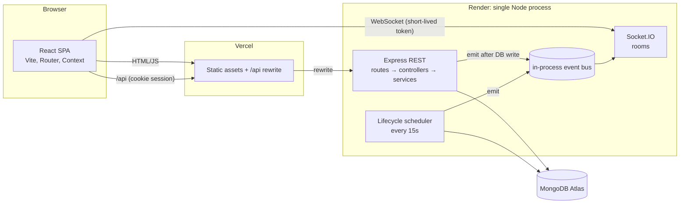
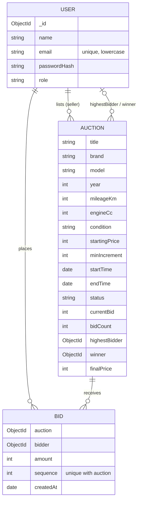
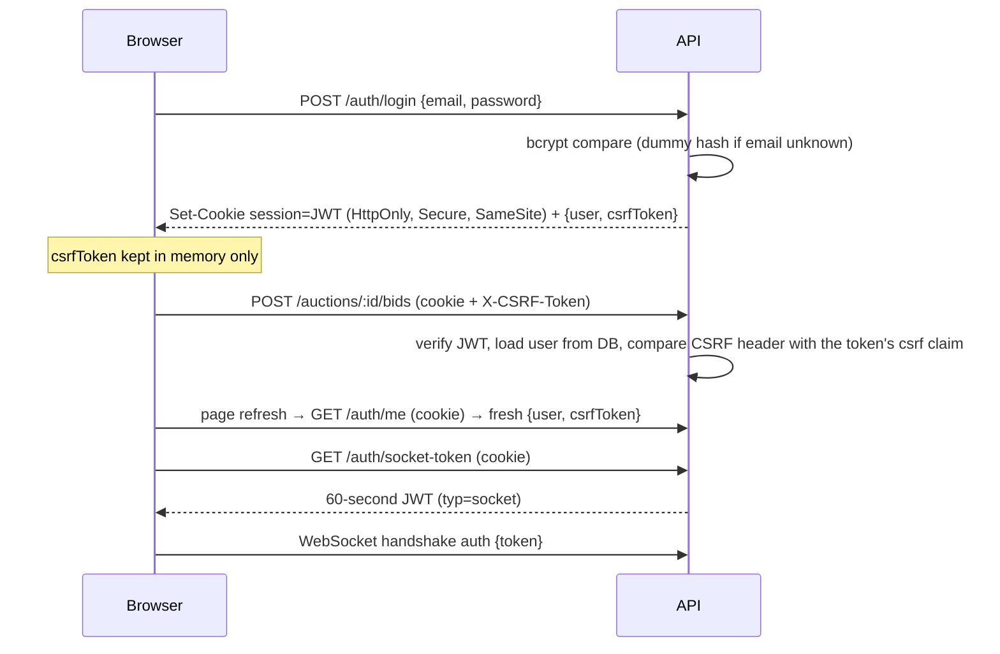
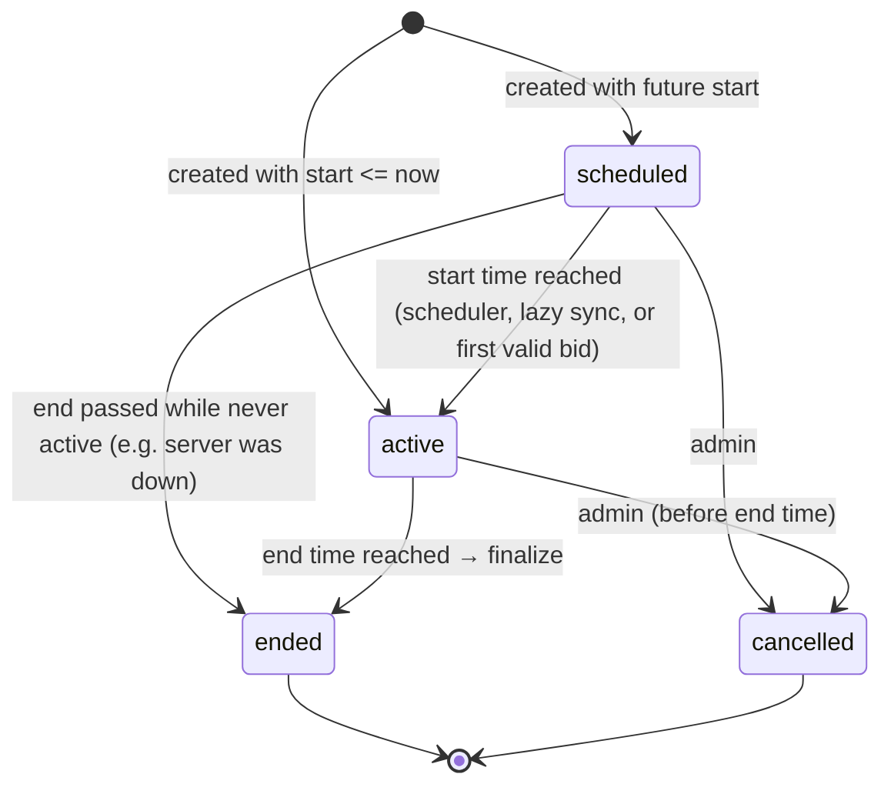

# Architecture

A modular monolith: one Express API (REST + Socket.IO), one React SPA, one MongoDB database.
No queues, no cache, no microservices. Each addition would have to justify itself against the requirements.

## 1. System overview



| Layer | Responsibility |
| --- | --- |
| React client | Rendering, form validation for UX, countdown display, socket subscriptions. Holds no business rules that the server doesn't re-check. |
| Express API | Authentication, authorization, validation, all business rules, persistence. |
| Services | `bidService` (accepting bids), `lifecycleService` (activation/finalization), `auctionService` (queries, admin edits), `authService`. |
| Socket.IO | Fan-out of events that services have already committed. Also accepts `auction:placeBid`, delegating to the same `bidService`. |
| MongoDB | Source of truth. Bids are an append-only log; auction fields are a derived summary. |

## 2. Data model



Design notes:

* **Bid** is the authoritative history. `Auction.currentBid / highestBidder / bidCount` are a denormalized summary kept so lists, sorting and price filters are plain indexed queries. The winner is always derived from `Bid`, never from the summary.
* `currentBid` equals `startingPrice` until the first bid; `bidCount === 0` means "no bids". This keeps price sorting/filtering simple. The one rule that depends on the distinction is `minimumNextBid` (first bid may equal the starting price; later bids must add `minIncrement`), implemented once in `utils/auctionRules.js`.
* Amounts are integer rupees. No floating point money.
* Indexes: `User.email` unique; `Auction {status,endTime}`, `{status,startTime}`, `{createdAt}`, `{brand}`, `{seller,createdAt}`; `Bid {auction,sequence}` **unique**, `{auction,createdAt}`, `{bidder,createdAt}`.

## 3. API overview

All responses: `{ success: true, data, meta? }` or `{ success: false, code, message, details? }`. Pagination: `?page=&limit=` returning `meta {page, limit, total, totalPages}`.

| Area | Endpoints |
| --- | --- |
| Auth | `POST /api/auth/register`, `POST /api/auth/login`, `POST /api/auth/logout`, `GET /api/auth/me`, `GET /api/auth/socket-token` |
| Auctions (public read) | `GET /api/auctions` (`q, brand, condition, status, minPrice, maxPrice, sort=endingSoon|newest|priceAsc|priceDesc, page, limit`), `GET /api/auctions/filters`, `GET /api/auctions/:id`, `GET /api/auctions/:id/bids` |
| Bidding (auth) | `POST /api/auctions/:id/bids` body `{ amount }` |
| User (auth) | `GET /api/users/me/bids`, `GET /api/users/me/auctions` (grouped: leading, outbid, won, lost, cancelled) |
| Admin (auth + admin role) | `GET /api/admin/dashboard`, `GET/POST /api/admin/auctions`, `GET/PATCH /api/admin/auctions/:id`, `GET /api/admin/auctions/:id/bids`, `POST /api/admin/auctions/:id/cancel`, `POST /api/admin/lifecycle/run` |
| Ops | `GET /api/health` (liveness), `GET /api/ready` (pings MongoDB) |

Error codes the client relies on: `VALIDATION_ERROR`, `AUTH_REQUIRED`, `TOKEN_EXPIRED`, `INVALID_TOKEN`, `CSRF_INVALID`, `FORBIDDEN`, `EMAIL_TAKEN`, `INVALID_CREDENTIALS`, `AUCTION_NOT_FOUND`, `AUCTION_NOT_STARTED`, `AUCTION_ENDED`, `AUCTION_CANCELLED`, `OWN_LISTING`, `ALREADY_HIGHEST`, `BID_TOO_LOW` (with `details.minimumNextBid`), `BID_CONFLICT`, `FIELD_LOCKED`, `AUCTION_LOCKED`, `INVALID_TRANSITION`, `RATE_LIMITED`.

## 4. Authentication



* Session JWT: HS256, 8-hour expiry, no silent refresh (the user signs in again). Algorithms are pinned on verify; `typ` claims stop a session token being used as a socket token or vice versa.
* The role is read from the database on every request, so demoting a user takes effect immediately.
* **CSRF**: cookie auth with `SameSite=None` (needed for cross-origin deployments) is CSRF-exposed, so every state-changing authenticated request must echo the per-session `csrf` claim in `X-CSRF-Token`. A cross-site page cannot read that value or set the header (CORS allow-list blocks the preflight).
* **Sockets** use the short-lived token above, not cookies. This avoids relying on third-party cookies for WebSockets and removes cross-site WebSocket hijacking as a concern.
* Admin accounts are only created by `npm run seed`. Public registration always creates buyers, and the `role` field is stripped by validation.

## 5. Auction lifecycle



Transitions are defined in `utils/auctionRules.js`; the code that performs them always includes the *current* state in the update filter, so an invalid transition matches nothing.

**Where it runs.** Three triggers, all calling the same idempotent functions:

1. A `setInterval` scheduler in the API process (every 15 s) plus one catch-up run at boot (handles sleeping Render instances).
2. A throttled lazy sync (≤1/s) at the start of list/detail/activity/admin requests.
3. `placeBid` itself decides eligibility from the database and `new Date()` on the server, never from the stored status alone: an auction past its end time rejects bids even if the scheduler hasn't flipped it yet.

**Finalization** (`finalizeAuction`):

1. Load the auction only if it is open and `endTime <= now`.
2. Count its `Bid` documents. If the count differs from `auction.bidCount`, a bid is mid-flight → defer to the next run (after a 30 s grace it proceeds from the `Bid` collection to recover from a crash).
3. Winner = highest `amount` (earliest `sequence` breaks ties) among stored bids. No bids → `ended` with no winner.
4. Write `status, winner, finalPrice, finalizedAt` with absolute `$set` values, filtered on `status ∈ open` and `bidCount`. Re-running matches nothing (or writes identical values), so a duplicate winner cannot arise. An in-process guard prevents two overlapping runs from emitting the status event twice.

**Admin edit rules.** Scheduled: all fields. Active: only description, location, images (price, increment and timing are locked once bidding may have happened). Ended/cancelled: immutable. Winners and bids are never editable through any endpoint. Cancel: allowed for scheduled/active auctions that have not reached their end time; bids are retained.

## 6. Bidding and concurrency

```mermaid
sequenceDiagram
  participant C as Client
  participant S as bidService
  participant DB as MongoDB
  participant IO as Socket.IO
  C->>S: placeBid(auction, user, amount)
  S->>DB: read auction snapshot (bidCount = n)
  S->>S: validate with server time: status, window, owner, not already highest, amount ≥ minimum
  S->>DB: INSERT Bid {sequence: n+1}  (unique index auction+sequence)
  alt insert succeeds (this request owns position n+1)
    S->>DB: UPDATE auction SET currentBid, highestBidder, bidCount=n+1 WHERE bidCount=n AND open AND now in window
    S-->>IO: emit bid:accepted (after both writes)
    S-->>C: 201 accepted
  else duplicate key (another bid took n+1)
    S->>DB: apply the winner's pending bid to the auction (idempotent)
    S->>DB: re-read and re-validate (usually BID_TOO_LOW; retried up to 10×)
  end
```

**Why competing bids cannot both win.** Position `n+1` in an auction's bid log can be claimed only once: `Bid` has a unique index on `(auction, sequence)`, and unique-index enforcement is atomic in MongoDB. Of N requests that read the same snapshot, exactly one insert succeeds. The others re-read, re-validate against the new price, and are either rejected (`BID_TOO_LOW`) or, if their amount is still high enough, accepted as the *next* position. Because every accepted bid was validated against the previous accepted bid's state, accepted prices are strictly increasing by at least `minIncrement`.

**The auction summary update** is deliberately idempotent: absolute `$set` values (no `$inc`) filtered on `bidCount = sequence − 1`. The owning request and any recovering request can both apply it without coordination. If an auction is cancelled or expires between insert and update, the update matches nothing, the never-applied bid is deleted, and the request is rejected.

**Crash between the two writes.** The `Bid` exists but the summary lags. The next bidder collides on the same sequence, applies the pending bid (recovery), and continues. Finalization also defers while counts disagree and recovers from the `Bid` collection after a grace period.

**Why not a transaction?** It would work on Atlas (replica set) but would couple correctness to a deployment feature, and a standalone `mongod` (e.g. local development) would not support it. The unique-index approach needs only standard MongoDB behaviour. If transactions were later preferred, the insert + summary update could be wrapped in one; the validation logic would not change.

**Why not rely on a conditional `findOneAndUpdate` alone?** An earlier version did. Under the test database used during development (FerretDB, see README) concurrent conditional updates could both match, and the unique index was what stopped corruption. That motivated making the unique index the primary mechanism. MongoDB itself guarantees single-document update atomicity, so this is belt and braces on Atlas rather than a workaround.

Other protections: per-user rate limit on bids (30/min) and per-socket (10/10 s); bid amounts must be positive integers ≤ ₹100 crore; a user who is already highest cannot re-bid (blocks double-submits).

## 7. Socket.IO event flow

| Direction | Event | Notes |
| --- | --- | --- |
| client → server | `auction:join { auctionId }` | Ack returns a fresh snapshot. The client re-joins on every reconnect. |
| client → server | `auction:leave { auctionId }` | |
| client → server | `auction:placeBid { auctionId, amount }` | Requires an authenticated socket; calls the same `placeBid` as REST. |
| server → room | `auction:bidUpdated` | `currentBid, minimumNextBid, bidCount, bidderCount, status, endTime, bid {id, amount, bidder (masked), createdAt}, serverTime`. |
| server → room | `auction:statusChanged` | Activated, ended, or cancelled. |
| server → `user:<id>` | `auction:outbid` | Private. Sent only to the previous highest bidder. |
| server → socket | `auction:error` | Validation/permission/business failure of that socket's own request. |

Events are produced by listeners on the in-process bus that services fire only after the database write succeeds, so a rejected bid can never produce a success-looking event. Payloads contain masked display names only (`R••• S.`), never ids, emails or tokens. "Bidder count" is the number of distinct bidders in stored bids, a number with no identity attached.

Client resilience: the connection indicator shows connected / reconnecting / unavailable. On reconnect the page re-joins and replaces its state with the snapshot, so missed events cannot leave a stale price. Bidding itself goes through REST, so a dropped socket never blocks or corrupts a bid.

## 8. Security measures

Password hashing (bcryptjs, cost 10, 72-byte cap) · HTTP-only, Secure, SameSite session cookie · CSRF header · pinned JWT algorithm and typed tokens · server-side role checks on every admin route · Zod validation and normalisation on every input (unknown fields stripped) · regex-escaped search · `helmet` headers · CORS allow-list from `CLIENT_URL` · 20 KB body limit · rate limits (API 300/min/IP, auth 20/15 min/IP, bids 30/min/user) · uniform login errors with a dummy hash compare · image URLs restricted to http(s) or site paths (blocks `javascript:`/`data:`) · stack traces and DB errors never returned · log redaction of keys matching password/token/secret/cookie/csrf/email · no secrets in the repo (`.env` ignored, `.env.example` has placeholders).

## 9. Observability

* One-line JSON logs: `time, level, message, requestId, …context`. HTTP requests (health probes excluded), `auction.created/updated/cancelled/activated/finalized`, `bid.accepted`, `bid.rejected` (code only, not amounts), `user.registered`, `auth.login`, `auth.login_failed` (no identifier), socket handler errors, and `request.error` for 5xx.
* `X-Request-Id` is accepted or generated, returned in the response, and included in request and bid logs.
* `/api/health` = process is up. `/api/ready` = MongoDB ping succeeds (503 otherwise). Neither exposes configuration.
* Graceful shutdown on SIGTERM/SIGINT: stop scheduler → close Socket.IO and HTTP server → disconnect MongoDB (10 s hard cap).
* No external monitoring, alerting or tracing is configured. Render's log stream and health check are the operational surface.

### Diagnosing common failures

| Symptom | Where to look |
| --- | --- |
| API won't start | First log line `Invalid environment configuration` lists missing variables. `server.start_failed` + `mongodb.error` means the Atlas URI or IP allow-list is wrong. |
| 503 from `/api/ready` | `mongodb.disconnected` / `mongodb.error` in logs; check Atlas status and network access. |
| Users can't log in after deploy | Cookie not stored: check `CLIENT_URL` matches the frontend origin exactly and that `/api` goes through the Vercel rewrite (or `SameSite=None` is in effect for direct cross-origin). `CSRF_INVALID` means the header wasn't sent. |
| Live updates show "unavailable" | `VITE_SOCKET_URL` unset/wrong; browser console shows `connect_error`. A sleeping Render instance takes ~30–60 s to wake. |
| "My bid was rejected" | Search logs for `bid.rejected` with the `userId`/`auctionId`; the `code` field is the reason (`BID_TOO_LOW`, `AUCTION_ENDED`, …). `bid.contention` at debug level shows races. |
| Auction not ending on time | `scheduler.started` should appear at boot; `auction.finalize_deferred` means counts disagree (a bid was in flight or a crash occurred). The admin dashboard has "Run lifecycle check". |

## 10. Scaling considerations

* **Horizontal API scaling.** REST is stateless (JWT), and bidding correctness lives in MongoDB (unique index), not in process memory, so running several API instances is safe for bids.
* **Socket.IO across instances.** Rooms are per-process. With more than one instance, a bid accepted on instance A would not reach clients connected to B. That is the point at which a shared adapter (Redis pub/sub, or MongoDB change streams) becomes necessary. It is deliberately **not** added now: a single instance serves this workload, and the event bus is the only seam that would change.
* **Scheduler.** With N instances every one runs the interval; that is safe because transitions are idempotent, just redundant. A dedicated cron/worker (or Atlas scheduled trigger) is cleaner at scale. On free hosting, sleeping instances make a reliable external trigger (cron calling `/api/admin/lifecycle/run` or a ping service) worthwhile; lazy sync and boot catch-up cover the gaps for this assessment.
* **Database.** Indexes cover the list, sort and activity queries. Atlas free-tier connection limits: Mongoose's default pool (100) is more than needed; lower `maxPoolSize` if running many instances. The "my auctions" classification reads at most 200 auctions/500 bids per user; beyond that it needs an aggregation.
* **Hot auctions.** A last-second rush contends on one auction's sequence number. Contention costs retries (bounded at 10); very high rates would call for per-auction serialization (queue/actor) rather than optimistic retries.

## 11. Failure scenarios

| Scenario | Behaviour |
| --- | --- |
| Socket disconnects mid-auction | UI shows "Reconnecting…", re-joins and refreshes on reconnect. Bids use REST so none are lost or duplicated. |
| Process dies between Bid insert and summary update | Next bid or finalization recovers from the `Bid` log (see §6). |
| Two bids at the same instant | One wins the sequence; the other is rejected or re-evaluated. |
| Server asleep/down at an auction's end | Boot catch-up and lazy sync finalize it; bids are rejected meanwhile because the window check uses server time. |
| Admin cancels during a bid | Whichever write lands first wins; a bid applied after cancellation matches nothing and is removed and rejected. |
| MongoDB unavailable | Requests fail with a generic 500; `/api/ready` returns 503; no partial state is created by validation-only paths. |
| Expired/invalid session | 401 with `TOKEN_EXPIRED`/`INVALID_TOKEN`; the client signs out and shows a notice. |

## 12. Assumptions and trade-offs

* Currency is INR; amounts are whole rupees.
* Admins never bid on their own listings (all seeded listings belong to the admin), and a seller cannot bid on their own auction.
* No soft-close/anti-sniping extension, proxy (max) bidding, buyer's premium, reserve prices, payments, escrow, shipping, chat, notifications by email/SMS, image uploads (URLs only), password reset, email verification, or account deletion.
* Bid history on the detail page shows the latest 15 bids; the admin view is paginated.
* Seed images are locally generated SVG illustrations (see README) rather than photographs.
* The client does no polling; the status of an auction that nobody is watching only changes via the scheduler/lazy sync, and clients refetch when their countdown elapses.
